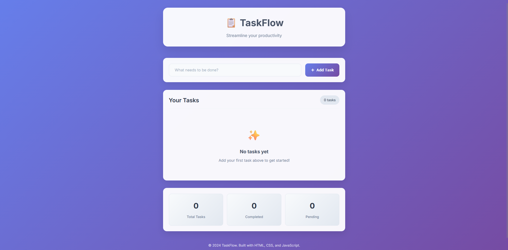
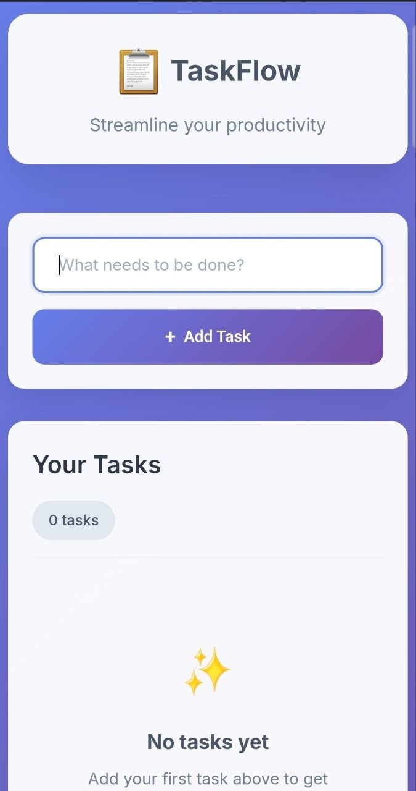

# TaskFlow - Task Management Application

> A modern, responsive task management app built with HTML, CSS, and JavaScript

## 🚀 Live Demo
⚠️ As of v3.0.0, TaskFlow needs a running backend — the GitHub Pages link below is static-only, so the UI loads but task creation/editing will fail (no `/api/tasks` to call). Run it locally instead: see [How to Run](#-how-to-run).

[https://thomas-more-devops.github.io/taskflow-group-7-IADI3/](https://thomas-more-devops.github.io/taskflow-group-7-IADI3/)

## 📊 Project Status


## 🎓 Course Context
This project is part of the **Bachelor International Business Management - Data Science, Protection & Security** course, **Week 2: Git Fundamentals**. It demonstrates:
- Modern web development practices
- Git workflow and collaboration
- Professional project documentation
- Responsive design principles
- Team-based software development

## 🚀 Features

- ✅ **Add Tasks**: Create new tasks with a simple, intuitive interface
- ✅ **Mark Complete**: Check off completed tasks with satisfying animations
- ✅ **Edit Tasks**: Modify task descriptions inline
- ✅ **Delete Tasks**: Remove tasks you no longer need
- ✅ **Persistent Storage**: Tasks are saved locally in your browser
- ✅ **Task Statistics**: View your productivity metrics
- ✅ **Responsive Design**: Works beautifully on desktop, tablet, and mobile
- ✅ **Modern UI**: Clean, professional interface with smooth animations

## 🛠️ Technologies Used

- **HTML5**: Semantic markup and modern web standards
- **CSS3**: Flexbox, Grid, custom properties, and animations
- **JavaScript ES6+**: Classes, modules, and modern syntax
- **Local Storage API**: Client-side data persistence
- **Google Fonts**: Inter font family for typography

## 📱 Screenshots

### Desktop View


*Professional task management interface with clean design*

### Mobile View


*Fully responsive design that works on all devices*

## 🏃 How to Run

TaskFlow now runs as a Node.js/Express backend serving a static frontend, and is fully containerized with Docker. Two ways to run it:

### Option A: Docker (recommended)

```bash
# 1. Clone the repository
git clone https://github.com/thomas-more-devops/taskflow-group-7-IADI3.git
cd taskflow-group-7-IADI3

# 2. Build the image
docker build -t taskflow:1.1 .

# 3. Run the container
docker run -d -p 3000:3000 --name taskflow-app taskflow:1.1

# 4. Open the app
# http://localhost:3000
```

Useful commands:
```bash
docker logs taskflow-app        # View server logs
docker stop taskflow-app        # Stop the container
docker rm taskflow-app          # Remove the container
```

If port 3000 is already taken on your machine, map to a different host port instead:
```bash
docker run -d -p 3001:3000 --name taskflow-app taskflow:1.1
# then open http://localhost:3001
```

### Option B: Node.js directly (no Docker)

Requires Node.js >= 22.

```bash
git clone https://github.com/thomas-more-devops/taskflow-group-7-IADI3.git
cd taskflow-group-7-IADI3
npm install
npm start
# open http://localhost:3000
```

### Verifying it works

```bash
curl http://localhost:3000/health
# {"status":"ok"}

curl -X POST http://localhost:3000/api/tasks \
  -H "Content-Type: application/json" \
  -d '{"title":"Test task from API"}'

curl http://localhost:3000/api/tasks
# The task you just created should be in the response, and visible
# in the browser at http://localhost:3000 after a refresh.
```

### API Reference

| Method | Endpoint          | Description              |
|--------|-------------------|---------------------------|
| GET    | `/health`         | Health check (`{"status":"ok"}`) |
| GET    | `/api/tasks`      | List all tasks            |
| POST   | `/api/tasks`      | Create a task (`{title, priority, category, dueDate}`) |
| PUT    | `/api/tasks/:id`  | Update a task              |
| DELETE | `/api/tasks/:id`  | Delete a task              |

Tasks are stored in-memory on the server, so they reset when the container/server restarts.

## 📋 Usage

### Adding Tasks
1. Type your task in the input field
2. Click "Add Task" or press Enter
3. Your task appears in the list below

### Managing Tasks
- **Complete**: Click the checkbox next to any task
- **Edit**: Click the edit icon (✏️) to modify the task text
- **Delete**: Click the delete icon (🗑️) to remove the task

### Viewing Statistics
The stats section shows:
- **Total Tasks**: All tasks you've created
- **Completed**: Tasks you've finished
- **Pending**: Tasks still to be done

## 💡 Learning Outcomes

Through this project, students learn:
- **Git Version Control**: Basic Git commands (add, commit, push, pull)
- **GitHub Collaboration**: Team workflows and pull requests
- **Professional Documentation**: README writing and code comments
- **Modern Web Development**: HTML5, CSS3, and JavaScript ES6+
- **Responsive Design**: Mobile-first CSS and flexible layouts
- **Data Persistence**: Local Storage API usage
- **User Experience**: Intuitive interface design and accessibility
- **Project Management**: Issue tracking and project organization

## 🎯 Learning Objectives

This project demonstrates:
- Modern HTML5 semantic markup
- CSS3 advanced features (Grid, Flexbox, animations)
- JavaScript ES6+ features (classes, arrow functions, template literals)
- Local Storage API for data persistence
- Responsive web design principles
- Progressive enhancement
- Accessibility best practices

## 📁 Project Structure

```
taskflow/
├── server.js                # Express backend (REST API + static file serving)
├── Dockerfile                # Container build
├── .dockerignore
├── package.json
├── public/                   # Frontend, served by server.js
│   ├── index.html
│   ├── styles/
│   │   └── main.css
│   └── scripts/
│       └── app.js            # Talks to the API (fetch), not localStorage
├── docs/
│   ├── SETUP.md
│   ├── FEATURES.md
│   ├── ARCHITECTURE.md
│   ├── CONTRIBUTING.md
│   └── RELEASE_RETRO_v2.0.0.md
├── .github/
│   ├── workflows/ci.yml      # CI pipeline
│   ├── ISSUE_TEMPLATE/
│   └── pull_request_template.md
├── screenshots/
│   ├── 1.png
│   └── 2.jpg
├── .gitignore
├── LICENSE
└── README.md
```

## 🛠️ Development Workflow

```bash
# Daily development workflow
git pull origin main                    # Get latest changes
git checkout -b feature/feature-name    # Create feature branch
# Make your changes to the code
git add .                              # Stage changes
git commit -m "feat: description"     # Commit with conventional message
git push origin feature/feature-name   # Push to remote
# Create Pull Request on GitHub for review
```

## 📈 Performance Metrics

- **Load Time**: <2 seconds on 3G connection
- **Lighthouse Score**: 95+ across all categories
- **Browser Support**: All modern browsers (Chrome 90+, Firefox 88+, Safari 14+)
- **Mobile Performance**: Fully responsive design with touch-friendly interactions
- **Accessibility**: WCAG 2.1 AA compliant

## 🚀 Deployment

As of v3.0.0, TaskFlow requires a running Node.js backend (`/api/tasks`), so it can no longer be deployed as a static site on GitHub Pages — the API routes would 404 there. See [How to Run](#-how-to-run) for Docker/Node.js instructions. Any host that can run a Docker container (or plain Node.js) works: Fly.io, Render, Railway, a VPS, etc.

### Local Development
See [How to Run](#-how-to-run) above — `docker build`/`docker run`, or `npm install && npm start`.

## 🌟 Key Features Explained

### Local Storage Integration
Tasks are automatically saved to your browser's local storage, ensuring persistence across sessions:

```javascript
// Automatic saving after every change
saveTasks() {
    localStorage.setItem('taskflow_tasks', JSON.stringify(this.tasks));
}
```

### Responsive Design
Mobile-first CSS approach with breakpoints for optimal viewing:

```css
@media (max-width: 768px) {
    .input-container {
        flex-direction: column;
    }
}
```

### Smooth Animations
CSS transitions and keyframe animations for delightful user experience:

```css
@keyframes slideIn {
    from { opacity: 0; transform: translateY(20px); }
    to { opacity: 1; transform: translateY(0); }
}
```

## 🎨 Design Principles

### Color Palette
- **Primary**: #667eea (Modern blue gradient)
- **Secondary**: #764ba2 (Complementary purple)
- **Success**: #48bb78 (Green for completed tasks)
- **Warning**: #ed8936 (Orange for notifications)
- **Error**: #e53e3e (Red for alerts)

### Typography
- **Font Family**: Inter (Google Fonts)
- **Hierarchy**: Clear heading structure with proper font weights
- **Readability**: Optimal line height and letter spacing

### User Experience
- **Intuitive Interface**: Clear visual hierarchy and familiar patterns
- **Immediate Feedback**: Real-time notifications and visual confirmations
- **Error Prevention**: Input validation and confirmation dialogs
- **Accessibility**: Semantic HTML and proper ARIA attributes

## 🔧 Advanced Features

### Keyboard Shortcuts
- **Enter**: Add new task when input is focused
- **Tab**: Navigate through interface elements
- **Space**: Toggle task completion (when focused)

### Data Export (Future Enhancement)
```javascript
exportTasks() {
    const dataStr = JSON.stringify(this.tasks, null, 2);
    const dataBlob = new Blob([dataStr], {type: 'application/json'});
    // Download as JSON file
}
```

### Statistics Tracking
Real-time task statistics with daily productivity metrics:
- Tasks created today
- Tasks completed today
- Overall completion rate
- Productivity trends

## 🤝 Contributing

We welcome contributions from students and developers! Please see our [Contributing Guidelines](docs/CONTRIBUTING.md) for detailed instructions.

1. Fork the repository
2. Create a feature branch (`git checkout -b feature/amazing-feature`)
3. Commit your changes (`git commit -m 'Add amazing feature'`)
4. Push to the branch (`git push origin feature/amazing-feature`)
5. Open a Pull Request

For more details, check:
- [Setup Guide](docs/SETUP.md) - Installation and development setup
- [Architecture Documentation](docs/ARCHITECTURE.md) - Technical implementation details
- [Feature Documentation](docs/FEATURES.md) - Comprehensive feature list

### Commit Message Convention
```
feat: add new feature
fix: resolve bug
docs: update documentation
style: formatting changes
refactor: code restructuring
test: add tests
chore: maintenance tasks
```

## 🧪 Testing

### Manual Testing Checklist
- [ ] Add new task
- [ ] Edit existing task
- [ ] Mark task as complete
- [ ] Delete task
- [ ] Verify persistence after page reload
- [ ] Test responsive design on different screen sizes
- [ ] Validate accessibility with screen reader

### Browser Compatibility
- ✅ Chrome 80+ (Recommended)
- ✅ Firefox 75+
- ✅ Safari 13+
- ✅ Edge 80+

## 📚 Resources

### Learning Materials
- [MDN Web Docs](https://developer.mozilla.org/) - Comprehensive web development documentation
- [JavaScript.info](https://javascript.info/) - Modern JavaScript tutorial
- [CSS-Tricks](https://css-tricks.com/) - CSS techniques and best practices

### Design Inspiration
- [Dribbble](https://dribbble.com/tags/task_management) - Task management UI designs
- [Behance](https://www.behance.net/) - Web design inspiration

## 📝 License

This project is open source and available under the [MIT License](LICENCE).

```
MIT License

Copyright (c) 2026 TaskFlow Contributors

Permission is hereby granted, free of charge, to any person obtaining a copy
of this software and associated documentation files (the "Software"), to deal
in the Software without restriction, including without limitation the rights
to use, copy, modify, merge, publish, distribute, sublicense, and/or sell
copies of the Software, and to permit persons to whom the Software is
furnished to do so, subject to the following conditions:

The above copyright notice and this permission notice shall be included in all
copies or substantial portions of the Software.
```

## 📞 Course Support

### Getting Help
- **Instructor**: Harun Kalkanci
- **Course Materials**: Available on course platform

### Technical Support
If you have any questions or need help:
- 📧 Open an issue on GitHub
- 📖 Check our [comprehensive documentation](docs/)
- 💬 Review the inline code comments
- 🎓 Consult the course materials
- 👥 Ask teammates during collaborative exercises

## 🏆 Achievements

This TaskFlow application demonstrates:
- **Modern Web Standards**: Using the latest HTML5, CSS3, and ES6+ features
- **Best Practices**: Following industry-standard development patterns
- **User-Centered Design**: Focusing on usability and accessibility
- **Performance**: Optimized for fast loading and smooth interactions
- **Maintainability**: Clean, well-documented, and structured code

## ✅ Shipped in v2.0.0

- [x] **Task Categories**: Color-coded categories (Work, Personal, Shopping, Health, Study)
- [x] **Due Dates**: Deadline tracking with overdue/due-today detection
- [x] **Priority Levels**: High, Medium, Low priority sorting
- [x] **Search & Filter**: Advanced task filtering, quick filters, and sorting

## 🎯 Future Enhancements

Potential improvements for version 2.1+ (each one is tracked as a [GitHub issue](https://github.com/thomas-more-devops/taskflow-group-7-IADI3/issues)):
- [ ] **Dark Mode**: Toggle between light and dark themes
- [ ] **Collaboration**: Share tasks with team members
- [ ] **Sync**: Cloud synchronization across devices
- [ ] **Offline Mode**: Service worker for offline functionality

## 🙏 Acknowledgments

- **Inter Font**: Beautiful typography by Google Fonts
- **Icons**: Unicode emoji set for consistent cross-platform display
- **Inspiration**: Modern task management applications like Todoist, Things, and Any.do
- **Community**: Open source contributors and web development community

## 🏆 Contributors

Thanks to all the students and developers who contributed to this project:

### Course Contributors (Week 2 - Git Fundamentals)
- [@s6v41k](https://github.com/s6v41k) - Student A: HTML documentation comments
- [@GorginuoTWF](https://github.com/GorginuoTWF) - Student B: CSS comments explaining design choices
- [@Babaika328](https://github.com/Babaika328) - Student C: JavaScript comments and error handling and ARCHITECTURE.md explaining code structure

### How to Become a Contributor
1. Complete the [setup instructions](docs/SETUP.md)
2. Pick an issue from our [project board](https://github.com/thomas-more-devops/taskflow-group-7-IADI3/projects)
3. Follow our [contributing guidelines](docs/CONTRIBUTING.md)
4. Submit a pull request for review

## 🔄 Version History

### v2.0.0 (Current)
- 🚀 Task priority levels (High/Medium/Low) with color-coded badges and sorting
- 🚀 Task categories (Work, Personal, Shopping, Health, Study) with filtering and breakdown stats
- 🚀 Due date tracking with overdue/due-today detection and animated warnings
- 🚀 Real-time search with term highlighting, quick filters, and advanced sorting
- 🎨 Professional repository structure: issue/PR templates, CI pipeline, contributing guidelines
- 🐛 Fixed CI pipeline silently skipping devDependency install (masked ESLint failures)

### v1.0.0
- ✨ Initial release with core functionality
- 🎨 Modern, responsive design
- 💾 Local storage persistence
- 📊 Basic statistics tracking
- 🔧 Complete CRUD operations

---

**Happy Task Managing! 🎉**

Built with ❤️ using modern web technologies.

*"Productivity is not about being busy, it's about being effective."*

---

## Getting Started with Git

This project is perfect for learning Git version control:

1. **Initialize Repository**:
   ```bash
   git init
   git add .
   git commit -m "feat: initial TaskFlow application"
   ```

2. **Connect to GitHub**:
   ```bash
   git remote add origin https://github.com/thomas-more-devops/taskflow-group-7-IADI3.git
   git push -u origin main
   ```

3. **Enable GitHub Pages**:
   - Go to repository Settings → Pages
   - Select "Deploy from a branch"
   - Choose "main" branch
   - Your live app will be available at your GitHub Pages URL

Ready to start your DevOps journey with TaskFlow! 🚀